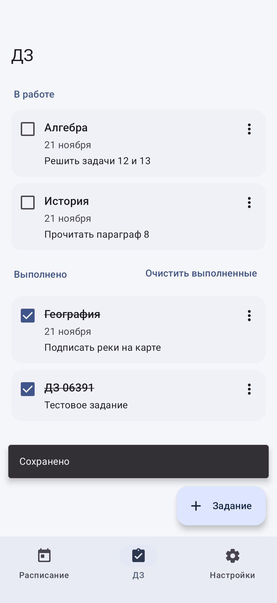

# Школьный день

Бесплатная программа с открытым исходным кодом для управления расписанием уроков и домашними заданиями.

  
  

## Установка

**Android 8.0 и новее.** После выхода версии скачайте APK со страницы [выпусков](https://github.com/sqeezy-53/school-day-android/releases) и откройте его на телефоне. Если Android попросит разрешить установку из этого источника, подтвердите её в системном диалоге.

Для обновления откройте APK новой версии.

## Участие в проекте

Нашли ошибку или хотите предложить улучшение?
Создайте [Issue](https://github.com/sqeezy-53/school-day/issues).

Хотите помочь с разработкой? Отправьте Pull Request.

[Сборка и выпуск](docs/release.md)

### Лицензия

Проект распространяется по лицензии GPL-3.0.
