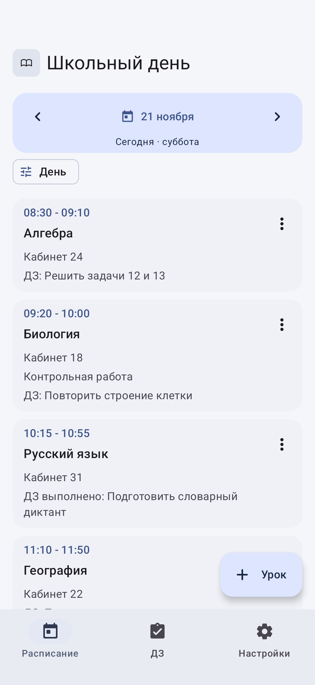
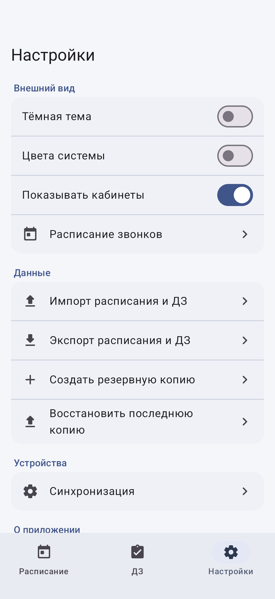

# Школьный день

Бесплатное приложение для расписания уроков и домашних заданий на Android. Данные автоматически синхронизируются с компьютером в одной локальной сети.

  
  

Настройки приложения

## Установка

**Android 8.0 и новее.** После выхода версии скачайте APK со [страницы выпусков](https://github.com/sqeezy-53/school-day-android/releases) и откройте его на телефоне. Если Android запросит разрешение на установку из этого источника, подтвердите её в системном диалоге.

Для обновления откройте APK новой версии.

## Участие в проекте

Нашли ошибку? Создайте [Issue](https://github.com/sqeezy-53/school-day/issues) в основном репозитории.

[Сборка и выпуск](docs/release.md)

Проект распространяется по лицензии GPL-3.0-only.
